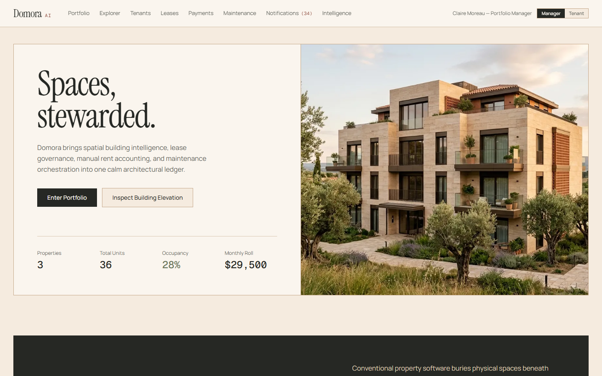
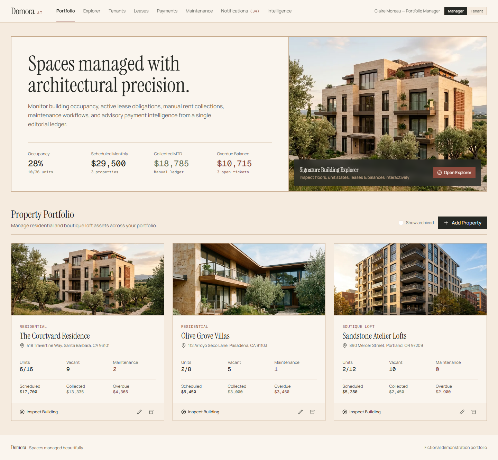
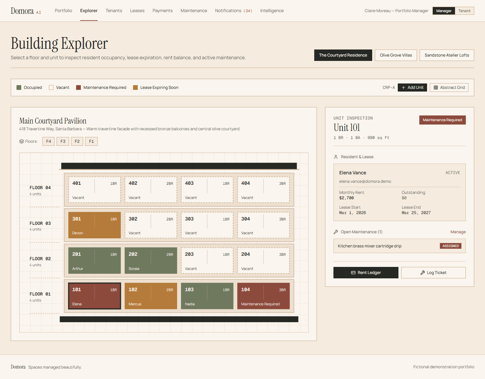
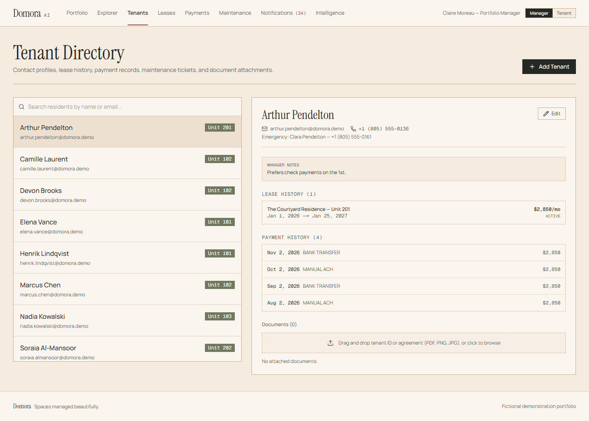
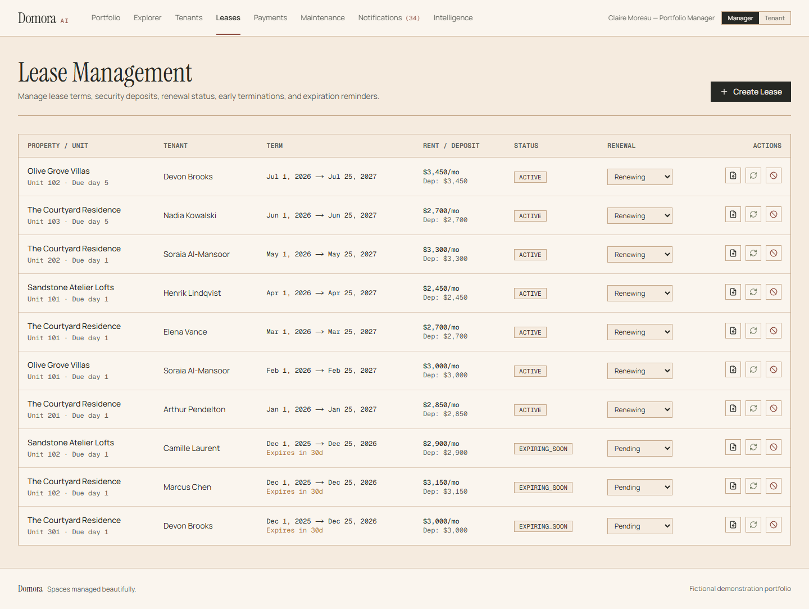
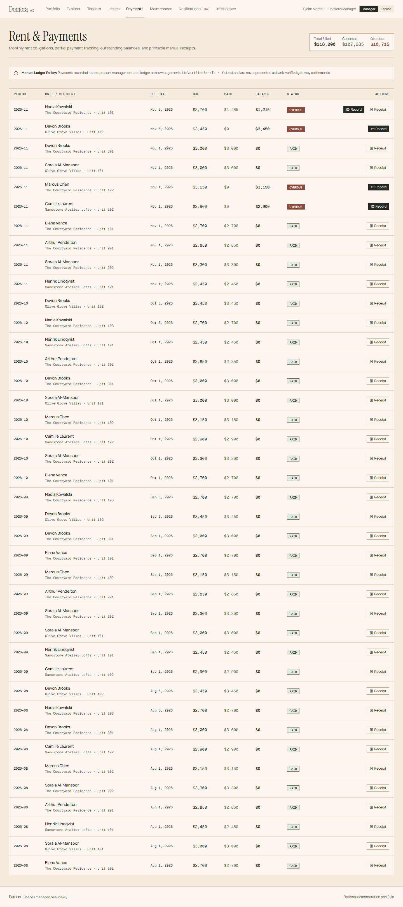
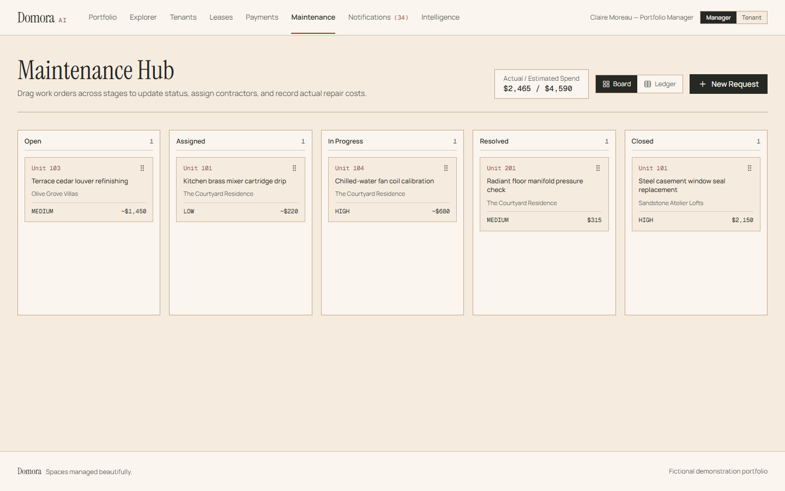
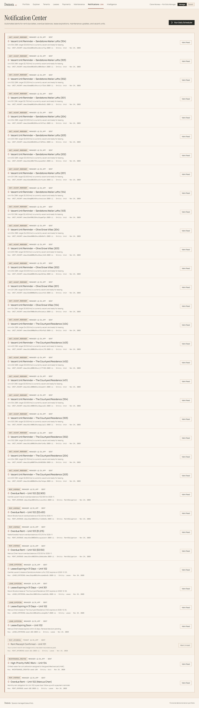
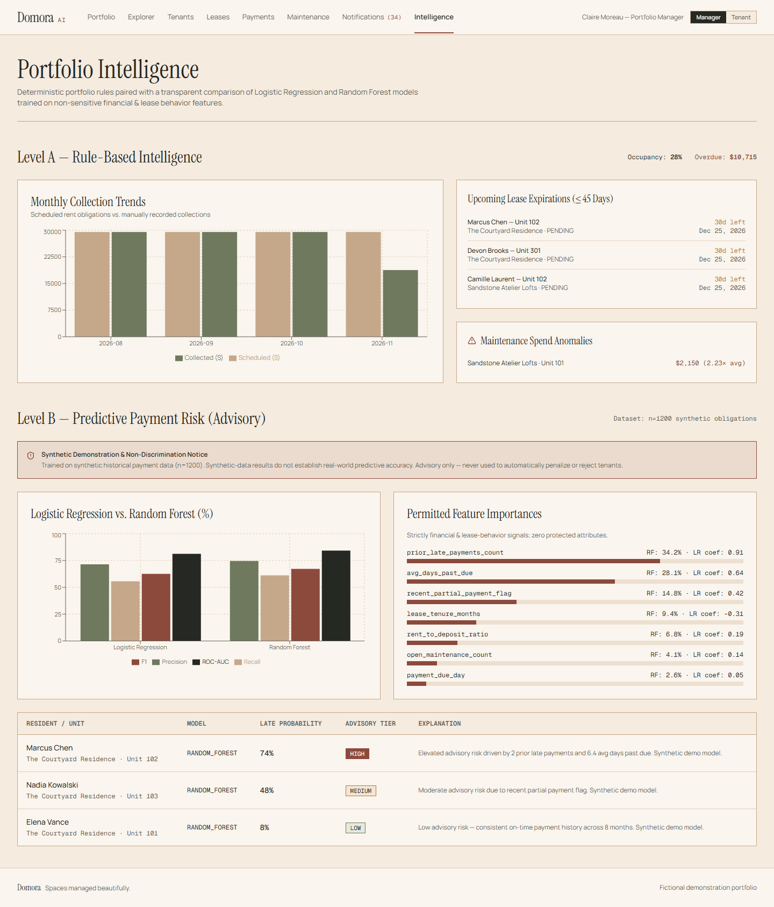

# Domora AI

**Spaces, stewarded.** An architectural-editorial property and tenant management platform built with Next.js 16 App Router, TypeScript, Tailwind CSS, PostgreSQL, Prisma ORM, Recharts, Motion, and scikit-learn.

Domora manages the complete rental-property lifecycle—from interactive SVG building elevations and resident dossiers to overlap-protected leases, transactional manual rent accounting, drag-and-drop maintenance workflows, idempotent scheduled notifications, and dual-layer portfolio intelligence.

---

## Pages & Feature Walkthrough

### 1. Editorial Landing Page (`/`)



The public entry point introduces Domora AI through an 11-section architectural-editorial layout backed by live PostgreSQL portfolio aggregates.

- **Asymmetric Hero & Live Portfolio Metrics**: Displays live counts for properties, total units, occupancy percentage, and monthly scheduled rent roll alongside architectural photography.
- **Charcoal Manifesto Band (`#262824`)**: Outlines Domora's three core principles—Spatial Truth, Atomic Accounting, and Non-Punitive Intelligence.
- **Full-Width Editorial Pull Quote**: Large-scale `Instrument Serif` typography framed by hairline sandstone borders.
- **Interactive Building Elevation Preview**: Clickable 3-floor / 9-unit preview grid that updates an adjacent unit inspection card with resident, rent, status badge, and notes.
- **Managed Architecture Photo Spread**: Asymmetric 6/3/3 gallery of portfolio properties linking directly to `/explorer` or `/portfolio`.
- **Dual Ledger & Maintenance Split**: Live month-to-date collected vs. overdue totals paired with the 5-stage maintenance pipeline and open ticket count.
- **Notification Queue & Intelligence Signal Previews**: Sample unread/read notification rows with left-border indicators and a 2×2 intelligence signal board.
- **Lifecycle Index & Triptych Architecture Footer**: Direct route index (`/explorer`, `/tenants`, `/leases`, `/notifications`, `/intelligence`), 3-image property strip, and technical stack summary.

---

### 2. Property Portfolio (`/portfolio`)



The central operational overview for property managers, plus a server-scoped **Resident Portal** when switched to the Tenant role.

- **Portfolio KPI Strip**: Live aggregates for Total Units, Occupied vs. Vacant Units, Monthly Scheduled Rent, Month-to-Date Collected Rent, Overdue Amount, and Open Maintenance Requests.
- **Property Cards with Architectural Photography**: Each building card displays address, unit occupancy breakdown, scheduled vs. collected rent, overdue balance, open maintenance count, and quick actions.
- **Create, Edit & Archive Properties**: Modal/drawer workflows validated with Zod on the server (`POST /api/properties`, `PATCH /api/properties/[id]`) to add new buildings, update details, or archive inactive properties.
- **Tenant Role Isolation**: Switching to **Tenant Demo (Elena Vance)** in the header transforms `/portfolio` into a resident-only portal showing only her assigned unit, active lease, payment history, and maintenance requests.

---

### 3. Interactive Building Explorer (`/explorer`)



Domora's signature spatial interface connecting physical building elevations directly to unit-level lease, financial, and maintenance records.

- **Interactive SVG Building Elevation**: Multi-floor architectural elevation diagram with clickable floor filters (`F4`, `F3`, `F2`, `F1`) and selectable unit bays.
- **Distinct Visual Unit States**: Color-coded and labeled using design tokens in `src/lib/tokens.ts`—`Occupied` (Olive), `Vacant` (Cream dashed), `Maintenance Required` (Terracotta), and `Lease Expiring Soon` (Sandstone/Amber).
- **Abstract Unit Grid Fallback**: One-click toggle (`Abstract Grid`) for buildings without physical architectural floor plans, preserving full unit selection without inventing floor plans.
- **Unit Inspection Panel**: Clicking any unit opens a live detail panel showing bedroom/bath/sq-ft specs, current resident, lease dates, monthly rent, outstanding balance, open maintenance tickets, and direct links to the Rent Ledger or Ticket Logger.
- **Add Unit Modal**: Managers can add new units directly to any floor via `POST /api/units`, updating the elevation immediately.

---

### 4. Tenant Directory (`/tenants`)



A searchable resident directory and dossier workspace designed with strict server-side data protection and fictional demonstration data.

- **Searchable Resident List**: Filter tenants by name, email, or unit number.
- **Add & Edit Tenant Profiles**: Create or update resident contact details, emergency notes, and profile metadata (`POST /api/tenants`, `PATCH /api/tenants/[id]`).
- **Complete Resident Dossier**: Displays associated unit, full lease history, payment history, active/past maintenance tickets, and manager notes in one view.
- **Drag-and-Drop Document Dropzone**: Upload lease PDFs or ID/inspection images (`PDF`, `JPEG`, `PNG`, `WEBP` up to 5 MB) with client and server MIME/size validation (`POST /api/documents`).

---

### 5. Lease Management (`/leases`)



Full rental agreement governance with domain-level conflict prevention.

- **Lease Creation with Conflict Guard**: Create leases specifying unit, tenant, start/end dates, monthly rent, security deposit, and payment due day (`POST /api/leases`). Overlapping active leases on the same unit are blocked at the domain layer (`hasOverlappingActiveLease`).
- **Renewal Status & +12 Month Renewal**: Track `PENDING`, `RENEWED`, or `NOT_RENEWING` statuses and extend expiring leases by 12 months in one click.
- **Early Termination**: Terminate active leases cleanly with server-side status updates (`PATCH /api/leases/[id]`), freeing the unit for re-leasing.
- **Expiration Reminders & Lease Documents**: Highlights leases expiring within 45 days and links uploaded lease PDFs directly to the agreement.

---

### 6. Rent & Payments (`/payments`)



Transparent manual rent accounting with atomic PostgreSQL transactions and explicit ledger provenance.

- **Monthly Rent Obligations**: Displays scheduled monthly obligations per lease with computed statuses (`PENDING`, `PARTIAL`, `PAID`, `OVERDUE`).
- **Transactional Payment Recording**: Record full or partial manual payments (check, ACH, cash, wire reference) inside a PostgreSQL `$transaction` (`POST /api/payments`), atomically updating `paidAmount` and obligation status.
- **Partial Payments & Outstanding Balances**: Accurately tracks partial settlements and remaining balance due on every obligation.
- **Honest Manual-Ledger Receipts**: Every recorded payment is explicitly labeled as a manual manager entry—never conflated with verified bank/Stripe settlements.

---

### 7. Maintenance Hub (`/maintenance`)



End-to-end work-order orchestration with both a drag-and-drop Kanban board and a structured table view.

- **Drag-and-Drop Kanban Board & Table Toggle**: Drag tickets across all 5 lifecycle columns (`Open` → `Assigned` → `In Progress` → `Resolved` → `Closed`) with immediate `PATCH /api/maintenance/[id]` persistence, or switch to a dense ledger table.
- **Create Maintenance Requests**: Both managers and tenants (scoped to their own unit) can submit requests with unit, category, priority, and problem description (`POST /api/maintenance`).
- **Contractor Assignment & Cost Tracking**: Assign vetted contractors from the database, log resolution notes, and track estimated vs. actual repair costs.
- **Resolution Timestamps**: Automatically records `resolvedAt` when a ticket moves to `Resolved` or `Closed`.

---

### 8. Notification Center (`/notifications`)



A persistent, duplicate-proof notification queue backed by a daily scheduler.

- **Six Event Categories**: Covers upcoming rent due dates, overdue rent, lease expiration alerts, new maintenance requests, maintenance status changes, and vacant unit reminders.
- **Idempotent Daily Scheduler**: Trigger the daily job on demand via **Run Daily Scheduler** (`POST /api/jobs/daily`) to evaluate obligations, leases, and vacant units across the portfolio.
- **Duplicate Prevention (`eventKey`)**: Uses deterministic `eventKey` unique constraints in PostgreSQL so re-running the scheduler never creates duplicate alerts for the same event.
- **Read/Unread Management & Delivery Status**: Filter unread vs. all alerts, mark individual or all notifications as read (`PATCH /api/notifications`), and inspect in-app or optional SMTP delivery status.

---

### 9. AI Intelligence (`/intelligence`)



Dual-layer portfolio analytics combining deterministic business rules with non-punitive predictive modeling.

- **Level A — Rule-Based Intelligence**:
  - Portfolio occupancy rate and vacancy breakdown.
  - Overdue balance totals and aging highlights.
  - Upcoming lease expirations (45-day window).
  - Maintenance spend anomaly detection (`detectMaintenanceSpendAnomalies` flagging properties above statistical spend thresholds).
  - Monthly rent collection trend charts built with Recharts.
- **Level B — Predictive Analytics (`ml/train_and_evaluate.py`)**:
  - Compares **Logistic Regression** vs. **Random Forest** on permitted non-sensitive lease and payment features to estimate payment-lateness probability.
  - Reports Precision, Recall, F1, and ROC-AUC from `ml/evaluation_report.json`.
  - Clearly discloses synthetic-data limitations and enforces a strict non-punitive policy (predictions are advisory only and never auto-penalize or reject tenants).

---

## Tech Stack

- **Frontend**: Next.js 16 App Router, TypeScript (`strict`, `noImplicitAny`, `noUncheckedIndexedAccess`), Tailwind CSS v4, Recharts, Motion, Lucide Icons
- **Backend**: Next.js Route Handlers, Zod validation, PostgreSQL 16, Prisma ORM 7 (`@prisma/adapter-pg`)
- **ML Pipeline**: Python `scikit-learn`, `pandas`, `numpy` (`ml/train_and_evaluate.py`)
- **Testing**: Vitest + React Testing Library

## Quick Start

1. **Install dependencies**:
   ```bash
   npm install
   cp .env.example .env
   ```

2. **Start PostgreSQL**:
   - **With Docker**:
     ```bash
     docker compose up -d
     ```
   - **Without Docker (embedded PGlite PostgreSQL wire server)**:
     ```bash
     npm run db:local
     ```

3. **Push schema & seed demo data**:
   ```bash
   npx prisma db push --config prisma7.config.ts
   npm run db:seed
   ```

4. **Run the application**:
   ```bash
   npm run dev
   ```
   Open `http://localhost:3000`.

## Verification & Testing

```bash
npm run typecheck
npm run lint
npm test
npm run build
```

## Documentation

- [Database ERD](docs/ERD.md)
- [Architecture](docs/ARCHITECTURE.md)
- [Functional & Non-Functional Requirements](docs/REQUIREMENTS.md)
- [Notification Processing](docs/NOTIFICATIONS.md)
- [ML Evaluation Report](docs/ML_EVALUATION.md)
