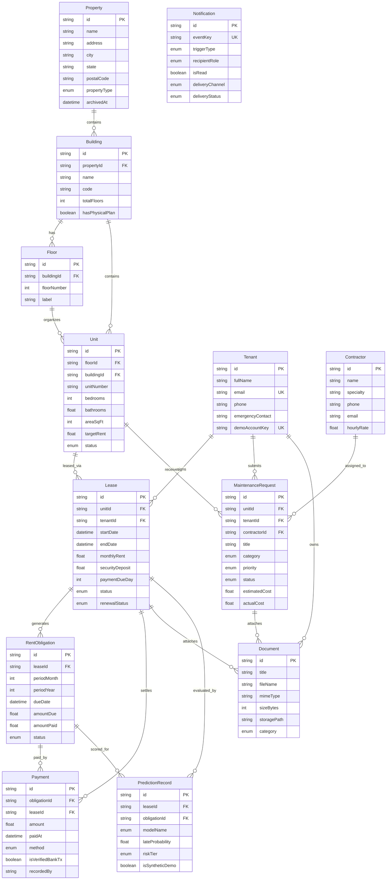

# Domora AI — Database Entity-Relationship Diagram

Domora AI uses **PostgreSQL** with **Prisma ORM** (`prisma/schema.prisma`, initial migration in `prisma/migrations/0001_init/migration.sql`).

## Key Relational Constraints
- **`RentObligation`**: `@@unique([leaseId, periodYear, periodMonth])` prevents duplicate monthly billing cycles.
- **`Notification`**: `@@unique([eventKey])` guarantees zero duplicate notifications for the same event.
- **`Lease`**: Server-side transaction verifies `hasOverlappingActiveLease` before creating an active lease on any `Unit`.
- **`Payment`**: Always recorded inside `prisma.$transaction`, atomically updating `RentObligation.amountPaid` and `RentObligation.status`, with `isVerifiedBankTx = false` for manual ledger entries.
